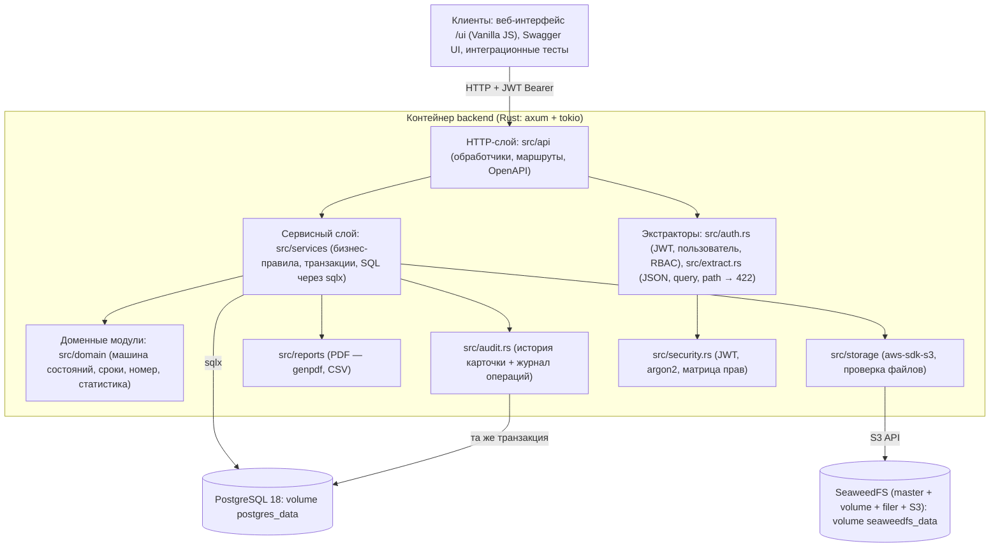
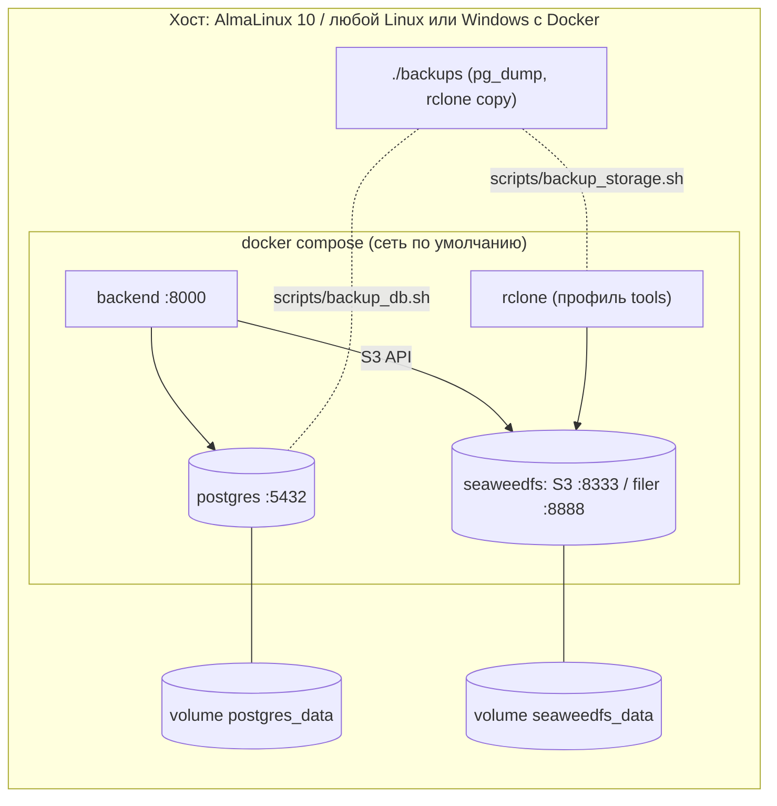

# Архитектура

Клиент-серверная система: REST API на Rust (axum), данные в PostgreSQL, файлы в распределенном хранилище объектов SeaweedFS (доступ по S3 API). Все три компонента работают в отдельных контейнерах Docker Compose. Веб-интерфейс — статические файлы (`ui/`), которые раздает тот же контейнер backend по адресу `/ui`; данные он получает только через REST API. Кроме того, API доступен через Swagger UI (`/docs`, схема генерируется из кода библиотекой utoipa) и проверяется интеграционными тестами.

## Компоненты и слои



Правила разделения слоев, которые соблюдаются в коде:

1. **Обработчики тонкие.** Обработчик объявляет путь, схемы OpenAPI, требуемые права (тип экстрактора `Authorized<can::…>`) и вызывает одну функцию сервиса. Бизнес-логики и SQL в обработчиках нет.
2. **Сервисы** содержат все правила: проверки ссылок, дат, переходов статусов, контекстные ограничения доступа. Сервисы управляют транзакциями (`pool.begin()` … `commit()`); незавершенная транзакция откатывается при выходе из области видимости.
3. **Ошибки** — значения типа `AppError` (`src/error.rs`) со статусом, кодом и полем; они реализуют `IntoResponse` и превращаются в единый формат `{detail, code, field}`. Ошибки разбора JSON, параметров строки запроса и пути тоже приводятся к этому формату (422) собственными экстракторами.
4. **Строки БД** (`src/models.rs`, `FromRow`) и **схемы API** (`src/dto.rs`, `Serialize`/`Deserialize` + `ToSchema`) разделены. Для PATCH-запросов используется тип `Patch<T>`, который различает «поле не передано» и явный `null`.
5. **Чистые доменные модули** (машина состояний, шаблон номера, контроль сроков, матрица прав, расчет показателей отчетов, CSV, проверка файлов) не зависят от БД и HTTP и покрыты unit-тестами.

## Прохождение запроса (пример: смена статуса)

```mermaid
sequenceDiagram
    autonumber
    participant C as Клиент
    participant R as Обработчик /incoming/{id}/status
    participant D as Экстрактор Authorized<ChangeStatus>
    participant S as services::documents
    participant W as domain::workflow
    participant DB as PostgreSQL

    C->>R: POST {status, comment} + Bearer JWT
    R->>D: проверка токена (до разбора тела)
    D->>DB: SELECT users WHERE id = sub (роль и активность — из БД)
    D-->>R: 401 / 403 или пользователь
    R->>S: change_status(actor, id, data)
    S->>DB: BEGIN; SELECT … FOR UPDATE (блокировка карточки)
    S->>W: transition_roles(old, new)
    W-->>S: None → 409 · роль не та → 403
    S->>DB: UPDATE status + INSERT document_history (одна транзакция)
    S->>DB: COMMIT
    S-->>C: 200 DocumentDetail (реквизиты, резолюции, вложения, история)
```

## Веб-интерфейс

Каталог `ui/` — четыре файла без сборки: `index.html`, `api.js`, `app.js`, `styles.css`. Сервер раздает его через `tower_http::services::ServeDir` (`src/api/mod.rs`); корень `/` перенаправляет на `/ui/`. Контракт REST API при переходе на Rust не изменился, поэтому интерфейс работает без правок.

- `api.js` — единственное место, где выполняются HTTP-запросы. Он подставляет `Authorization: Bearer`, превращает ответы `{detail, code, field}` в `ApiError` и при 401 очищает токен.
- `app.js` — маршрутизация по `#`-адресам (`#/documents`, `#/documents/{id}?tab=…`, `#/correspondents`, `#/reports`, `#/users`, `#/dictionaries`), экраны ролей, формы, валидация и уведомления. Разметка строится через `document.createElement`, данные выводятся как текст (без `innerHTML`), поэтому HTML в данных не исполняется.
- Видимость разделов и кнопок вычисляется из разрешений `GET /auth/me`. Это удобство, а не защита: права и переходы статусов проверяет backend, интерфейс лишь показывает его ответ.

## Сквозные механизмы

| Механизм | Реализация |
|---|---|
| Аутентификация | `POST /auth/login` выдает JWT (HS256), в котором только `sub` = user_id и срок жизни. Роль и активность при каждом запросе читаются из БД (экстрактор `CurrentUser`), поэтому смена роли или деактивация действуют сразу. Пароли — argon2id; проверка выполняется в `spawn_blocking`, для несуществующего логина время ответа выравнивается. |
| RBAC | `src/security.rs`: функция `role_permissions` «роль → набор разрешений» — единственный источник истины. Проверку выполняет экстрактор `Authorized<P>` (набор разрешений задается типом, `src/auth.rs`). Контекстные ограничения (исполнитель видит только свои поручения) — `services::documents::assert_can_view`. |
| Транзакции | Регистрация, смена статуса, создание и редактирование резолюций, загрузка файла выполняются в одной транзакции вместе с записью истории. Карточка блокируется `SELECT … FOR UPDATE`. |
| Номер регистрации | Атомарный `INSERT … ON CONFLICT DO UPDATE … RETURNING` в `registration_counters`, формат из `REG_NUMBER_TEMPLATE`, плюс `UNIQUE` в БД. |
| Файлы | Хранилище — SeaweedFS (S3-шлюз, клиент `aws-sdk-s3`, path-style, контрольные суммы только когда их требует операция). Проверки: расширение, MIME и сигнатура содержимого, размер не более `MAX_UPLOAD_SIZE_MB` (тело multipart читается не более чем на 1 байт сверх лимита). Ключ хранения генерирует сервер. Если запись в БД не удалась, объект удаляется из хранилища. Скачивание — потоковый ответ через backend после RBAC-проверки; SeaweedFS наружу не публикуется. |
| Контроль сроков | `src/domain/deadlines.rs`: состояния `ok`, `warning` (осталось не больше `DEADLINE_WARNING_DAYS` дней), `overdue`, `closed`. Выводятся в каждой карточке, есть фильтр `deadline_state`, учитываются в отчетах. |
| Журналирование | История карточки хранится в БД. Остальные операции (вход, неудачный вход, пользователи, отчеты, выгрузки, удаление) пишутся структурированными строками `action=… actor=… details=…` (`tracing`, цель `app.audit`) в stdout. Пароли, JWT и ключи хранилища в логи не попадают. |
| PDF | `genpdf` (альбомный A4, таблица с повторяющейся строкой заголовка, номера страниц), шрифт DejaVu Sans; потоки сжимаются (`lopdf`). Формирование — в `spawn_blocking`. |
| Health | `GET /health` и `GET /api/v1/health` проверяют `SELECT 1` в БД и `HeadBucket` в SeaweedFS (тайм-аут 3 с каждая). Ответ 200 или 503. |
| Миграции | SQL-файлы `migrations/` встраиваются в бинарный файл (`sqlx::migrate!`) и применяются при старте. Операторы идемпотентны (`IF NOT EXISTS`), поэтому база прежней Python-версии подхватывается без пересоздания. |
| Остановка | Бинарный файл — PID 1 контейнера (`ENTRYPOINT ["correspondence"]`), получает SIGTERM; `axum::serve(...).with_graceful_shutdown` перестает принимать соединения и дожидается текущих запросов, затем закрывается пул соединений. |

## Развертывание



Образ backend собирается в два этапа: `rust:1-slim-trixie` компилирует release-сборку (слой зависимостей кэшируется отдельно от исходного кода), рабочий образ `debian:trixie-slim` содержит только бинарный файл, каталог `ui/` и шрифт DejaVu; процесс работает от непривилегированного пользователя. Healthcheck backend — встроенная команда `correspondence healthcheck` (curl в образе не нужен).

У всех сервисов есть healthcheck и политика `restart: unless-stopped`. Backend стартует после того, как postgres и seaweedfs прошли healthcheck, и при старте применяет миграции; бакет создается фоновой задачей, которая повторяет попытки, пока хранилище не станет доступно. Порты PostgreSQL и SeaweedFS опубликованы только на `127.0.0.1`.

## Структура каталогов

```
src/
  main.rs               точка входа: serve | migrate | seed | healthcheck
  lib.rs                сборка состояния (пул БД, миграции, клиент хранилища)
  config.rs             настройки из окружения / .env
  error.rs              AppError и единый формат ошибок
  extract.rs            экстракторы JSON / query / path с ошибками 422
  auth.rs               CurrentUser, Authorized<P>, наборы разрешений can::*
  security.rs           матрица прав, JWT, argon2
  models.rs             перечисления и строки таблиц (sqlx::FromRow)
  dto.rs                схемы запросов и ответов, валидация, Patch<T>
  audit.rs              история карточки и журнал операций
  db.rs                 пул соединений, встроенные миграции
  seed.rs               демонстрационные данные
  domain/               workflow.rs, deadlines.rs, reg_number.rs, stats.rs
  services/             users, dictionaries, correspondents, documents, resolutions, attachments, reports, exports
  storage/              mod.rs (SeaweedFS через S3 API), validation.rs (файлы)
  reports/              pdf.rs (genpdf), csv.rs
  api/                  обработчики по разделам, маршруты, OpenAPI
migrations/             SQL-миграции
scripts/                backup/restore (pg_dump, rclone)
tests/http.rs           HTTP-слой без инфраструктуры
tests/docs.rs           соответствие документации коду
tests/api.rs            интеграционные: REST API + PostgreSQL + SeaweedFS
docs/                   диаграммы и документация
ui/                     веб-интерфейс: index.html, api.js, app.js, styles.css
```

## Совместимость с Draw.io

Все диаграммы в `docs/` написаны на Mermaid. В Draw.io (diagrams.net) их можно вставить через **Arrange → Insert → Advanced → Mermaid** и доработать вместе с диаграммами курсовой. Диаграмма вариантов использования дополнительно приведена на PlantUML в `docs/use-case.md`.
